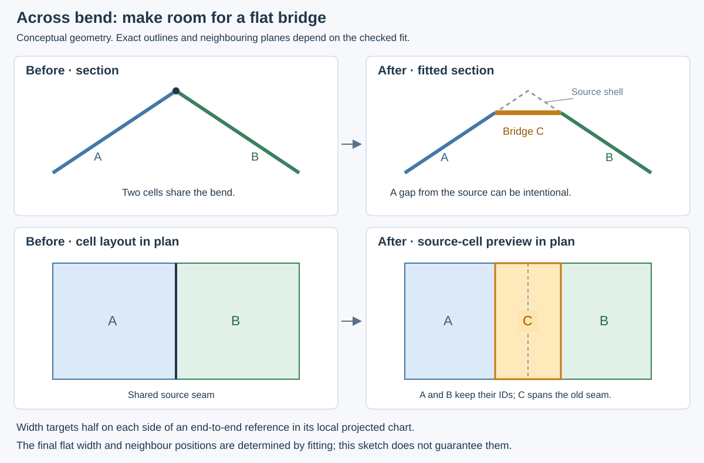

# Add a cell across a bend

**Across bend** creates a narrow cell centred on the shared seam between two
neighbouring cells. It takes a strip from each side, leaving the two original
cells smaller and adding one new cell. When the panels are fitted, the new cell
can become a flat bridge or chamfer across the bend.

The source shell stays unchanged. The new cell's source patch follows that
shell, including its bend; the fitted panel is a separate flat part. Its middle
can sit away from the source surface. That departure is intentional, and the
usual shell-deviation measurements still include it. Neighbouring planes and
outlines can adjust to make their shared edges meet.

## Preview and apply

1. Enable **Modify → Across bend**, then click a shared source-cell seam. You can
   also select two adjacent cells before enabling the tool. It switches to
   **Cells** view with parts assembled so the source arrangement is visible.
2. Check the highlighted pair and seam. Enter **Width (mm)**. The tool checks
   the source strip, then calculates a fitted preview in the background.
3. Inspect both ends and both remaining neighbours. Change the width to make the
   strip useful without leaving narrow scraps. Wait for the checked preview
   before choosing **Apply**. Amber shows the new panel; dashed outlines show its
   source boundary. The status distinguishes a source-only preview from a
   completed fitted preview and reports panels that still need attention.
4. **Apply** commits the source edit and recalculates flat panels and solids.
   Inspect **Flat** and **Solid**, including the neighbours. A successful source
   preview does not promise that the requested stock geometry will resolve.
5. **Cancel** or **Escape** discards the preview. Changing editing mode or opening
   another document also cancels it. **Undo** restores an applied change;
   **Redo** reapplies it.

The fitted preview includes the two trimmed neighbours. Other fitted panels can
also adjust when the complete arrangement is recalculated. Apply accepts a
checked source edit; it remains available while the fitted preview is pending
or unresolved. Review the preview status before deciding to apply it.

Changing the preview width does not change the saved arrangement. If the source
checks reject Apply, the existing layout is kept and the message explains what
needs changing. A source edit that passes those checks remains editable and
saveable even if downstream panel fitting is unresolved.

## What the width means

The input is the **total target width**. The tool draws a straight reference
between the seam's endpoints in each neighbouring cell's local projected editing
chart. It places a cut half the requested width to the inside of each cell,
perpendicular to that reference. On flat sides with a straight seam, this is
half the width along each surface. Curved sides or a bowed seam make it a
projected target; distances from the actual seam and along the shell can differ.

The dashed preview boundary shows the actual source patch that will become the
new cell. The width is not a promise of constant distance along a curved surface,
nor the final flat panel's cutting width. Flattening across a bend changes the
relationship between those distances, and fitting may move shared corners or neighbouring
planes. Use the final panel measurements and Rhino export for the resulting
part dimensions.

The first version follows one **open, unbranched shared seam** between two cells.
A bowed seam is usable when the proposed strip contains its entire path and the
two trimmed cells remain usable. If the seam curves outside the strip, the tool
asks for a wider strip or a different seam. The cuts follow the end-to-end
references; they are not constant-distance curves around every bend in the seam.

The strip stops at the boundary of the two cells' combined region. Existing
junctions and opening boundaries constrain its ends. It does not automatically
continue through a chain of cells. A width large enough to contain a strongly
curved seam may also consume too much of a neighbour, leaving no usable choice
until the source cells are reshaped.

## If the tool cannot make the strip

| What the message means | What to try |
| --- | --- |
| There is no suitable shared seam | Pick the common edge of two neighbouring cells. An outside edge, point contact or disconnected pair cannot supply two sides of a strip. |
| The seam curves outside the proposed strip | Increase the width enough to contain it, or choose a straighter seam. Check that the wider strip still leaves both neighbours usable. |
| The pair shares several seams, a closed loop or a branching meeting | Choose two cells with one open shared seam, or divide/reshape the local region first. |
| The width leaves a tiny or disconnected neighbour | Reduce the width, or move the surrounding corners to give both remaining cells usable area. |
| The strip would enclose an opening | Reduce the width, or divide the cells beside the opening so the new strip can remain one usable piece. |
| This curved patch cannot be handled in the local editing view | Try a smaller local region or a different seam. A patch that folds over itself in the projection cannot be cut reliably by this version of the tool. |
| A cell or shared source boundary is protected | Unlock the affected cells before changing their arrangement. |
| The study already has 500 cells | Merge cells before adding another. The current edit limit includes manually added cells. |
| The new flat part or its thick edges do not resolve | Inspect the new part and both neighbours. Try another width, reshape the source cells, reduce stock demands, or use Rhino repair for manual work. |

Rejected edits do not prove that a bridge is impossible to design. They mean
that this particular seam, width and source arrangement do not pass the tool's
current checks. The tool requires connected source pieces, usable remaining
cells, consistent shared boundaries and complete coverage of the original shell.
It does not fill openings or discard difficult pieces to force an edit through.

## Identity, offsets and saving

The two trimmed cells keep their panel IDs. The new cell receives its own stable
ID. Previewing alone does not consume an ID; an ID reserved when Apply starts
remains retired if that attempt is cancelled or rejected, so panel numbers may
have gaps.

Offsets on the two trimmed cells are cleared because their source patches have
changed. Other cells keep their offsets. The UI reports this reset, and Undo
restores the earlier offsets and arrangement. Edit protection is respected,
including shared source boundaries affected by the cut.

Save a study to retain the accepted cell arrangement. Named checkpoints and local
save/resume also retain it. Reopening restores the authored layout and recalculates
the fitted parts; future fitting improvements may change the calculated outlines.
Keep a handoff package when the exact exported geometry of an approved revision
must be preserved.

The tool creates a source arrangement for the normal shared-plane fitter. It does
not impose a fixed bridge angle or a hard constraint that the two neighbouring
planes remain unchanged. Production export still requires the current flat and
solid checks, including the selected carving option.

For a useful issue report, give the selected panel IDs, width, visible build date,
and what the preview or fitted bridge did differently from what you expected.
Attach a screenshot or study through **Report an issue** when useful; those
attachments are separate choices and are not uploaded automatically.

See [how panels are fitted](how-panels-are-fitted.md),
[panel offsets](offset-panels.md), and
[the review and handoff workflow](project-review-workflow.md) for the surrounding
design and production checks.
