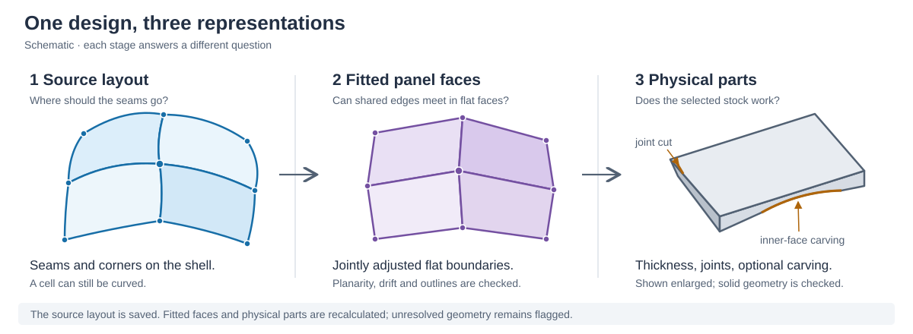
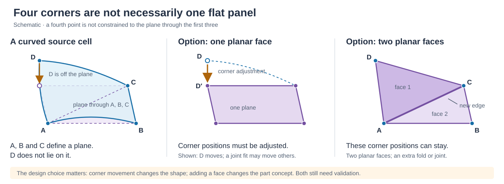
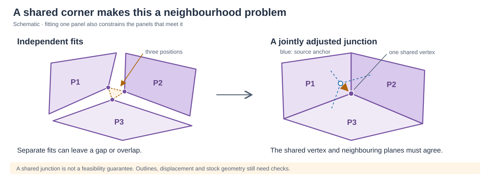
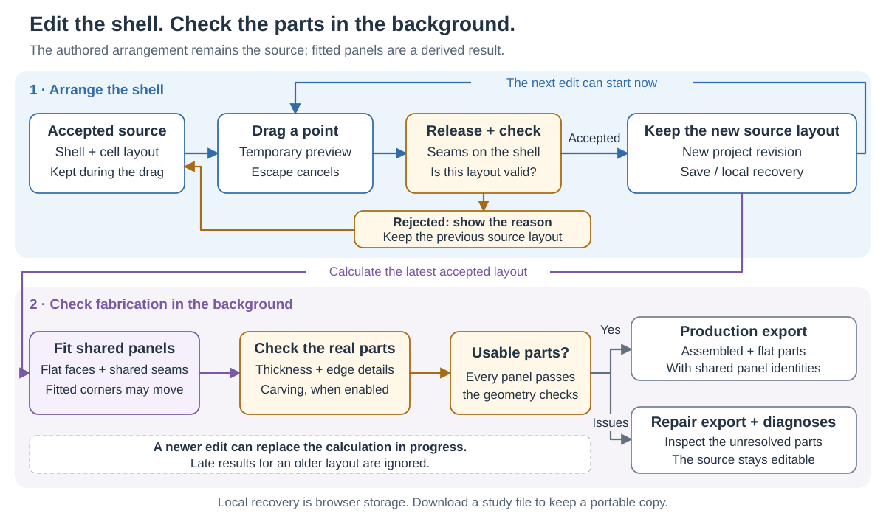

# From a shell to buildable panels

Panel Workbench starts with the designer's arrangement on a shell. Moving a
corner on that shell is a valid way to design the arrangement. The extra work
comes when we ask the same arrangement to become **flat, thick parts that meet
one another**, while preserving openings and staying reasonably close to the
original shape.

This guide explains that distinction and the current algorithm. The drawings
are exaggerated schematics, not screenshots or fabrication drawings. The
implementation described here is the durable-v6 release of 2026-10-30; the source
links at the end identify the relevant functions.

## One design, three representations



| Representation | What it contains | What the designer can conclude |
| --- | --- | --- |
| **Cells on the shell** | Regions of the source mesh, with shared seams, corners and stable cell IDs | This is the accepted arrangement you drew. It can still produce unresolved parts. |
| **Fitted flat panels** | A plane for each panel or compatible panel group, with jointly calculated boundary vertices | The result approximates the source. Check planarity, outline validity and displacement. |
| **Solid parts** | Thickness, matching cut faces, roundovers and, when selected, carving | These additional checks can fail even when the flat panel is valid. |

The shell imported from Rhino is a mesh for these calculations. Its triangles
are flat individually, but a cell usually covers many differently oriented
triangles. Drawing a boundary around that patch does not make the whole patch
one plane. Native surface/control-point fitting is not what the browser is
performing.

The accepted source layout is the editable document. Fitting and stock settings
do not silently redraw it. **Show fitting changes** displays the difference
between corresponding source and fitted boundaries; the selected panel's
**Corner shift** measures displacement of retained boundary anchors. That is a
different measurement from deviation across the complete source patch.

## Why sliding corners is not enough for a flat part

Three non-collinear points define a plane. A fourth arbitrary point on a curved
shell will generally lie outside that plane. More corners add more planarity
conditions, not a guarantee that the face is flat.



For example, take three corners at `(0, 0, 0)`, `(1000, 0, 0)` and `(1000, 1000, 0)`
mm. Their plane is `z = 0`. A fourth corner at `(0, 1000, 40)` mm does not lie
in that plane. A best-fit plane could distribute the error among all four
corners; keeping the first three fixed would require moving the fourth by
40 mm. These are illustrative coordinates, not a tolerance or a measured case.

There are several possible physical interpretations:

- Make one flat part, allowing some fitted corners to depart from the shell.
- Divide the region into more parts. Two triangles can each be flat, with a
  fold or joint between them; they are no longer the same single flat part.
- Use a bent or otherwise nonplanar part, which is a different manufacturing
  model from this tool's flat-panel construction.

The browser already triangulates surfaces for drawing and mesh calculations.
Those display triangles do **not** automatically become separately manufactured
parts. Likewise, **Divide cell** creates a new source seam; it does not impose a
permanent requirement that both resulting panels share one plane. The fitter
may keep compatible neighbours coplanar, but that is conditional.

## Why neighbours have to be solved together

Independently fitting the best plane for each panel is straightforward. The
problem is that each panel can then give a different location for the same
shared corner. Joining the resulting solids does not repair that disagreement.



For panel `i` and one of its boundary vertices `v`, the planarity condition is:

```text
n_i · x_v = d_i
```

Here `n_i` is the panel's unit normal, `d_i` locates its plane, and `x_v` is the
fitted corner position. A shared corner uses **one `x_v` for every incident
panel**. We also want `x_v` to remain near its source anchor and respect any
opening/rim constraints. This equation explains the geometry; it is not a claim
that the implementation solves one global objective to a proven optimum.

Three suitably independent planes normally have a common point. Almost parallel
planes can have a distant, unstable intersection. Four or more independently
chosen planes generally need adjustment to share one point. Moving one plane
also affects its other corners, which connect to more neighbours. A local edit
can therefore change fitted geometry beyond the directly edited cell.

Sharing coordinates prevents each owner from independently opening the same
seam. It does **not** prove that the resulting outline is simple, flat within
tolerance, close enough to the shell, or usable as a thick solid. A reported
zero seam gap is only one of the checks.

## What the current algorithm does

### 1. Establish or restore the source arrangement

A new arrangement uses the chosen generator: organic cells, a structured
hexagonal/geodesic layout, or the regularized layout. Existing accepted layouts
are restored from their stored source graph when the generation inputs match.
They are not regenerated merely because stock thickness changes.

For organic generation, seed-distance fields are computed along the mesh graph
and interpolated/clipped within source triangles. This approximates surface
distance; it is not an exact continuous-geodesic calculation.

A direct edit changes that graph. The application projects the move onto a local
connected region of the mesh, updates the affected seams and rebuilds affected
cell patches. Boundary junctions stay attached to their source perimeter.
Merging removes an internal seam; dividing adds one and assigns a new panel ID.
A centre move in an authored layout moves the surrounding corner network; it is
not simply relocating a decorative dot. Organic centre movement before direct
edits or merges still uses its seed-driven generation path; the authored graph
path preserves the earlier seam edits.

Before accepting the edit, source validation checks the resulting partition:
attachment, usable connected regions, boundary/seam consistency and coverage.
A crossed seam or a folded local editing chart can reject the **source edit**.
That is distinct from an accepted layout that later fails **panel fitting**.

### 2. Build a shared fitting network

The fitter collects common boundary vertices and their panel owners. It
simplifies boundary paths while retaining shared junctions and editing handles.
Internal seams are reduced to shared straight chords between retained nodes;
perimeter curves are approximated subject to the boundary-simplification policy.

Planar source openings can supply shared trim constraints. When the whole shell
lies on one side of such a plane, fitted parts must stay on that side. This is
why the open bottom cannot be treated as an unconstrained collection of points.
A curved rim still has to be approximated by straight panel edges; preserving
its opening does not mean reproducing every curved boundary exactly.

### 3. Reconcile panel planes and shared vertices

The fitter initially groups compatible nearly coplanar neighbours. This helps
avoid extreme intersections of slightly different, almost parallel planes.
Groups spanning incompatible rim chords are kept separate.

It then alternates plane fitting and shared-vertex adjustment. These use repeated
small 3×3 calculations, not one giant dense matrix for the whole model. The current worker
requests 700 initial relaxation passes, with bounded extra passes for grouping,
edge-order and crossing constraints. Boundary conditions and limits on movement
constrain those adjustments. More iterations are not a proof of success.

After relaxation, shared intersections are calculated and checked again. If an
intersection is non-finite or too far from the source, the preview keeps a
bounded shared candidate and reports the problem instead of displaying a long
spike as a valid part.

### 4. Validate, and try bounded coupled repairs

The fitter checks the flattened outlines, planarity, source/rim movement and
shared-intersection stability. It can then try small changes to the offending
plane groups and their neighbours, considering unrounded stock geometry as well
as the flat outline.

The default repair budget is 240 candidate evaluations, capped at 480; trial
plane tilts stay within 3° of the initial plane. The
search is bounded in angle and movement, and accepts improvements only when they
do not introduce newly bad flat or tested stock panels. It is a limited repair
search, not an exhaustive feasibility test. Rounded/carved solids still require
their later checks.

### 5. Construct and check physical parts

Thickness offsets the faces. Neighbour relationships determine matching side
cuts and mitres; the solid builder adds the selected edge roundovers and checks
its mesh and joints. Offsetting a thin or sharply angled region can collapse or
cross a boundary that was valid at zero thickness.

With carving enabled, the inner face follows nearest points on the triangulated
reference mesh while the opposite face remains fixed. This uses a spatial search
structure, not a cutter-direction ray or machining simulation. Additional samples and checks measure remaining
material, stock overrun, surface folds and mesh consistency. A flat-outline pass
does not guarantee a successful carving pass.

A production export requires the relevant current checks to pass. A Rhino repair
export retains unresolved candidates and their reasons for manual work. Neither
export calculates the full CAM setup, cutter access, fastening or structural
performance. See [Rhino objects and linked blocks](rhino-workflow.md).

## Why an apparently small edit can fail

| Geometric situation | What goes wrong | What to inspect or try |
| --- | --- | --- |
| A cell spans strong curvature | Its desired corners and one plane are incompatible without substantial movement | Compare source/fitted outlines; change the seam arrangement or divide the region |
| Nearly parallel neighbouring planes | Small angular changes can move their intersection a long way | Inspect corner shift and neighbouring panels, rather than only the selected face |
| A very short shared edge | Its endpoints can collapse or reverse order during fitting | Inspect both owners of the seam; adjust the neighbouring arrangement or remove an unnecessary short edge |
| A constrained opening or rim | Staying on the rim competes with planarity and neighbouring plane intersections | Check the boundary cells together; retain the intended opening when adjusting them |
| Thick stock, mitres or carving | Offsets can cross, joints can disagree, or carving can leave too little material | Inspect the solid-specific reason and the chosen thickness/carving settings |
| A source move crosses a seam or folds its local chart | The attempted partition itself is invalid or unsupported by that local editing method | Try a smaller move or another local arrangement; the previous accepted layout remains available |

A diagnosed two-panel failure involved a short shared edge reversing during
fitting: one resulting outline overlapped and the other crossed. Relaxing the
validation would have admitted real bad geometry. Increasing the iteration
budget alone did not resolve that case. The measured case and the limits of the
repair experiments are recorded in [production readiness](production-readiness.md#confirmed-geometric-failure-a-short-shared-edge-reverses-during-fitting).

A failed search means **this implementation did not find a valid result within
its constraints and budget**. It does not prove that every possible arrangement
or manufacturing strategy is impossible. Conversely, a nicer-looking preview
is not evidence that an invalid part has become valid.

## Complexity: two different meanings

The **geometric complexity** is the coupling described above: source attachment,
flatness, shared joints, opening constraints and thickness can compete. The
**computational cost** is the work required to test and reconcile them.

| Cost driver | Why it matters in this implementation |
| --- | --- |
| Source triangles and local patch size | Projection, clipping and source reconstruction must examine mesh geometry; a folded chart can also require rejecting the edit |
| Number of panels, retained corners and owner relationships | Each fitting pass repeatedly updates planes and shared junctions |
| Boundary detail and openings | Some validity checks compare boundary segments pairwise; adding samples can increase that check faster than linearly |
| Difficult intersections and unresolved stock | Additional relaxation stages and bounded repair candidates repeat calculations |
| Roundovers and carving | More physical mesh samples and reference-surface queries add work beyond the flat fit |

There is no single useful runtime bound stated here for the entire pipeline.
For example, a pairwise segment check with `b` segments can require work
proportional to `b²`; that is a statement about that check, not a claim that the
whole application is quadratic. Mesh density, panel connectivity and which
repair branches run all matter. Nor has this implementation established that
its particular task is NP-hard. Fixed iteration budgets bound attempts; they do
not establish a convergence or optimality guarantee.

## How editing stays responsive



Dragging first creates a disposable local sketch. On release, a separate worker
validates the source transaction. If accepted, that source becomes the editable
revision and can be saved or recovered while a fitting worker calculates the
panels. Further source edits can continue; replies belonging to older requests
are discarded.

That separation is deliberate. The tool can accept a meaningful artistic
arrangement without pretending that all derived parts are resolved. A rejected
source move keeps the earlier arrangement. A later fitting failure keeps the
accepted new arrangement and its settings. Production exports wait for current
checks; study saving does not require a successful fit.

Exploded views and assembly guides are presentation transforms. They help trace
parts back to their assembled positions, but do not alter the accepted source,
solve panel geometry or add a fabrication constraint.

## Where to look in the code

| Module and main entry point | Responsibility |
| --- | --- |
| [`design.js` — `resolveSourceLayout`](../demo/design.js) | Restore the stored source or generate an explicit replacement |
| [`layout.js` — `captureLayout`, `restoreLayout`](../demo/layout.js) | Source graph, identities and validation of stored source geometry |
| [`layout-edit.js` — `transactLayout`](../demo/layout-edit.js) | Atomic corner/centre/merge/divide transactions |
| [`fitted.js` — `fitSharedPanels`, `buildNetwork`, `repairCoupledPlanes`](../demo/fitted.js) | Shared fitting, rim constraints, bounded repairs and diagnostics |
| [`solids.js` — `buildPanelSolids`](../demo/solids.js) | Thickness, cut faces, roundovers and solid checks |
| [`carving.js` — `buildCarvedPanels`](../demo/carving.js) | Reference-following carved geometry and material checks |
| [`worker.js` — `createWorkerHandler`](../demo/worker.js) | Stage ordering and separate validation/calculation requests |
| [`app.js`](../demo/app.js) | Disposable previews, request sequencing, views and export gates |
| [`study.js`](../demo/study.js) | Durable source document and calculation provenance |

For possible algorithmic improvements and libraries, see the
[research notes](research-notes.md). Those are research/adoption options, not
claims that the current implementation already uses them. For a first project
trial and useful feedback, see the [testing workflow](production-readiness.md#first-real-project-session).
