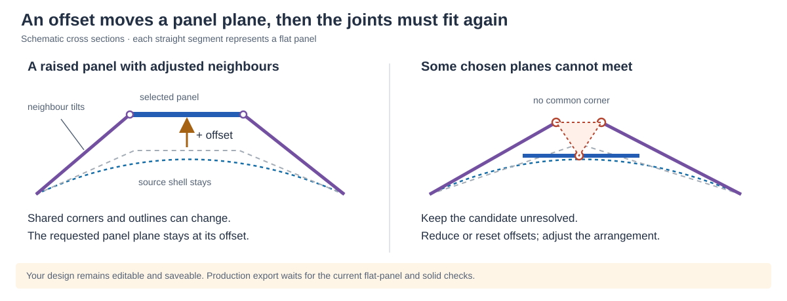

# Offset a panel while keeping flat parts

**Offset panel** changes a panel's position perpendicular to its face. Use it for
an intentional raised or recessed area in the assembled design. The chosen
panel remains constrained to a flat plane; neighbouring outlines, and sometimes
their angles, adjust so that shared edges can still meet.

An offset does not preserve the panel's original width or outline. It also does
not promise that every arrangement can be resolved. The original shell and its
authored cell boundaries remain the reference. **Explode panels** is a separate
inspection control; it does not set a design offset.

## Working with the control

1. Select one panel and enable **Offset panel**. This switches to **Flat** view
   and brings any exploded parts back to their assembled positions.
2. Drag its normal-direction handle, or enter a signed distance under
   **Panel offset · mm** and choose **Apply** or press Enter.
   Positive follows the displayed arrow; negative moves the opposite way. Orbit
   the view if the handle points towards the camera, or use the number field for
   precise movement. When viewed directly along the handle, dragging upwards
   increases the value. The number field's step arrows change the draft value;
   choose Apply to commit it. Hold Shift while dragging for finer movement.
3. Release the handle to calculate the assembled panels and stock again. Check
   the neighbouring panels as well as the selected one. The drag preview is a
   positioning aid shown as an amber outline; neighbours are recalculated on
   release. The completed calculation determines whether the parts resolve.
4. Use **Reset** beside the value to return this panel's offset to zero, or
   **Reset all panel offsets**, at the top of Properties, to clear every offset.
   This global reset remains available even if a calculation fails before any
   panel can be selected. **Undo** and
   **Redo** restore accepted offset changes. **Escape** cancels an unfinished
   drag and leaves editing mode. Changing another editing mode or the explosion
   amount also leaves the offset tool.

Start with small distances relative to the panel size. The input accepts values
up to ±10,000 mm to reject accidentally extreme or corrupt values; this is a file
and input limit, **not** a range of geometrically feasible offsets. A much smaller
move can fail at a constrained corner or opening.

Zero means the panel's normal fitted position for the current source layout and
settings. The distance is always measured from that baseline, so repeated
calculations do not add the offset again. Its positive direction is tied to the
source-oriented fitted normal. Changing **Flip inside / outside** changes the stock-side
interpretation; it does not silently reverse an authored offset.

## What changes, and what stays authored

An offset is a saved design setting attached to a panel ID. The fitter first
calculates the baseline arrangement, then applies the chosen plane offsets and
recalculates shared corners and unconstrained neighbours. It cannot quietly
reduce your requested value in order to report success. The selected plane is
kept at its requested position; an incompatible result remains unresolved.

On an entirely flat connected sheet, a local raised panel may not resolve with
the existing joints. A fallback can move the whole connected flat group together
if all its authored offsets agree. The UI reports how many panels moved and
suggests Undo if you wanted a local change. This fallback does not translate a
curved shell or silently replace conflicting authored values. The translated
group is still checked against the chosen stock, edge rounding and carving
settings.

Moving source corners or cell centres keeps offsets attached to surviving panels.
Because the underlying baseline fit can change, a saved distance follows that
panel's newly fitted plane rather than a fixed world coordinate. Recheck the
shape after source edits, thickness changes or carving changes.

With any panel offset active, centre handles move the checked source corner
network even in an Organic layout. The **Cell influence** slider is disabled:
redistributing seed regions could remove the panel to which an offset belongs.
Use corners and centres to reshape the arrangement, or reset all offsets before
changing generated influence.

At an opening, the fitted boundary may move along its opening plane as the
neighbours adjust. The source boundary stays authored in place, and the existing
opening-side and distance checks still apply to the fitted parts.

Merging or dividing cells clears offsets on the panels involved. Other panels
keep theirs. The UI reports this reset, and Undo restores the earlier layout
and values. **New arrangement** and **Reset cell edits** clear all offsets, since
they replace the layout those settings describe.

The fitted distance from the shell and corner-shift measurements still include
intentional offset displacement. A larger deviation can therefore be the result
you asked for. It is not automatically a fitting failure. Conversely, zero gap
along a shared seam does not prove that every panel is flat or that a thick part
can be manufactured.

## If a panel does not resolve

Select it in **Panels to resolve**. The explanation describes the visible
geometric problem and suggests an edit. An offset can affect a neighbour whose
own value is zero, so review the nearby offset panels too.

| What the message means | What to try first |
| --- | --- |
| The chosen panels cannot meet at one flat joint | Reduce or reset nearby offsets. If the shape needs a step, divide the region to give the surrounding panels more freedom. |
| A corner would move too far from the shell | Reduce the offset; inspect almost parallel neighbours and very short edges. |
| The panel conflicts with an opening | Reduce the offset or change the nearby source corners and centres while preserving the opening. |
| Edges cross, overlap or shrink to almost nothing | Inspect both sides of the seam; move the source corners apart, divide the region or merge an unwanted tiny panel. |
| The flat outline works, but thick edges do not meet | Inspect **Solid** view. Try less thickness, adjust the junction, or repair it in Rhino. |
| Carving exceeds the stock or leaves too little material | Adjust the offset or stock thickness, then check the remaining material again. |

These messages mean that the current calculation did not find usable geometry
under the chosen constraints. They do not prove that the design is impossible
with every arrangement or construction method. Near-parallel faces and meetings
of four or more planes can make shared corners especially restrictive.

You can still edit, Undo, reset offsets and **save the study**. Saving preserves
the chosen values even if panels are unresolved. Production export waits for the
current flat and solid checks. **Rhino repair** export includes the available
candidates and their diagnostic notes for manual work; it does not certify
those candidates as valid solids or cutting layouts.

## Saving and future versions

Study v6 records nonzero offsets with the required feature `panel-offsets-v1`.
A reader that does not support this feature must refuse the study with an
explanation, rather than open it while silently dropping the offsets. Existing
studies without offsets keep their previous meaning.

Local save and resume include accepted offsets when enabled. Keep a downloaded
study for portable backup. Reopening recalculates fitted parts and compares the
new result with the saved calculation evidence. The authored distance is
preserved; future fitting improvements may change neighbouring geometry, which
must still pass the current checks.

For a useful bug report, include the panel ID, offset value and visible build
date, the action that triggered the problem, and the expected shape. Download a
feedback report. Share the study privately if reproducing the geometry is
necessary; generating either download does not upload it.

## Checks behind this release

The numerical regressions cover positive and negative offsets, shared four-panel
corners, curved panels, opening edges, conflicting requested planes, bounded
failed candidates, disconnected sheets and exact restoration after Reset.
Persistence tests check old-file compatibility and reject unsupported offset
files before an older reader could discard their meaning.

`scripts/check-offset-browser.cjs` exercises real browser dragging, cancellation,
Undo/Redo, source edits, save/reopen, local recovery and actual Rhino 6 downloads.
The exported blocks and candidate outlines are compared with the calculated
offset geometry. This checks the file contents through the Rhino library;
native Rhino application use and fabrication still need project review.

On 2 November 2026, a private reference shell was also checked with 130 regularized
panels and 142 curvature-sized regularized panels. Interior ±10 mm, an edge-panel
+10 mm and a pair of +10/−10 mm offsets passed the flat and solid checks in both
layouts. A deliberately excessive 1,000 mm move remained bounded and unresolved;
Reset reproduced each baseline exactly. These are examples of tested changes,
not a guaranteed working distance for every panel.

See [the fitting algorithm](how-panels-are-fitted.md) for the shared-plane
calculation, [the project workflow](production-readiness.md) for save/recovery
limits, and [the Rhino workflow](rhino-workflow.md) for downstream repair and
production handoff.
