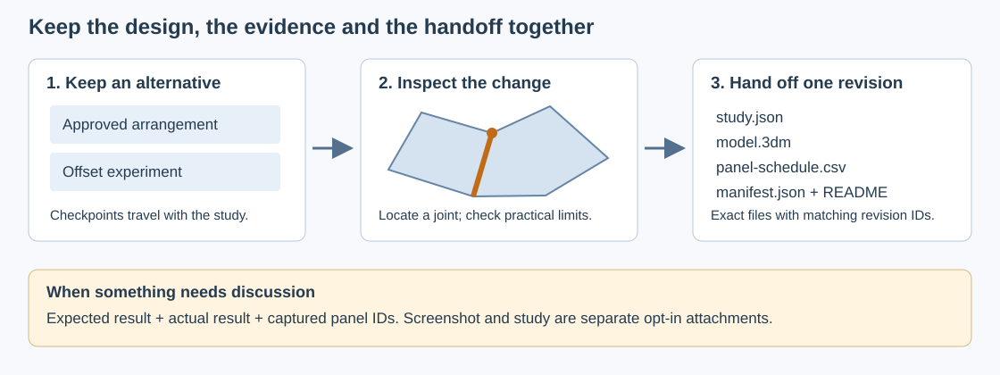

# Review, compare and hand off a shell

This workflow helps a designer understand a local problem, retain useful
alternatives and send a clearly identified revision to Rhino. It builds on the
[source editing and fitting workflow](how-panels-are-fitted.md), the
[panel offset control](offset-panels.md) and the durable study file.

## Inspect the affected joint

Use the inspection action beside a problem panel to frame that panel and its
neighbours. The rest of the assembly is temporarily hidden. The highlighted
segments or points identify a measured problem when the calculation can locate
one, such as crossing outline edges, a short edge or a corner that misses a flat
plane. The explanation states when only the affected panel or region is known.
The tool must not present a guessed seam as a proven cause.

The optional **Cutaway** control clips the displayed geometry so that the inside
of a joint can be seen. It does not cut the saved design or the exported parts.
Use the direction and position controls to expose the relevant face, and leave
inspection to return to the complete assembly. An inspection screenshot can
record that view when reporting a problem.

Inspect both the source arrangement and the thick parts. A shared edge may match
in Flat view while the stock geometry fails around it. Conversely, an intentional
offset can increase the measured distance from the original shell without being
a fitting error. A failed calculation is a statement about the current result,
not a proof that no arrangement or construction method could work.

## Keep named checkpoints

Open **File → Checkpoints**, enter a meaningful name and choose **Save checkpoint**.
For example, keep “Approved arrangement” before trying “Smaller entrance panels”.
A checkpoint preserves the accepted source design, settings and available
calculation evidence. It can be created while downstream fitting is unresolved;
unfinished source gestures must first be accepted or cancelled.

Named checkpoints belong to the study file. They are not the rolling automatic
recovery copies, and they are not automatically removed to make room for a new
checkpoint. A study supports up to eight named checkpoints within the same
128 MiB file limit. The source model is shared within the file, while each
checkpoint retains its own authored layout and design settings. Download a
backup before deleting an alternative you may want later.

- **Compare** recalculates the checkpoint with the current build. In Flat or
  Solid view, dashed outlines show the checkpoint's fitted parts; changed current
  panels are amber and added panels are green. The report also counts removed
  panels; review current failures under Panels to resolve. This may take a moment. The comparison
  is between two designs calculated now, not between the current design and a
  frozen historical mesh.
- **Restore** brings the checkpoint design back as a new revision of the current
  project. It keeps the named checkpoint collection and handoff history. The
  panels are recalculated and must pass the current checks.
- **Download** creates a portable study for that checkpoint, so it can be opened
  independently or shared deliberately.
- **Delete** removes the named checkpoint from the current study. It does not
  delete a previously downloaded file.

A named checkpoint preserves editing intent. It does not freeze the exact
derived mesh produced by every future solver. Keep an exported handoff package
when the exact geometry of an approved revision matters.

### Choose the right reset

The reset commands have different scopes:

| Command | What it returns to |
| --- | --- |
| **Reset cell edits** | A newly generated layout using the last applied layout settings. Clears moved centres, cell influence changes, merges, corner edits, divisions and all panel offsets. Stock settings and project limits stay in place. |
| **Reset direct edits** | The captured layout from before the first direct corner, centre, merge or divide edit. Restores the earlier arrangement, including any earlier corner constraints and merges. Offsets on surviving panel IDs remain; offsets on removed IDs are cleared. |
| **Reset corners** | Appears for older corner-constraint edits when there is no direct-edit baseline. Clears those corner targets and keeps merged cells. |
| **New arrangement** | Applies the draft layout controls and generates a replacement arrangement, clearing source edits and offsets. Organic layouts also receive a new random seed. |

These commands apply to the whole arrangement. Unlock protected cells first.
Use **Undo** to reverse a reset or return one accepted edit at a time; the
session keeps up to 30 edits. Use a named checkpoint to return to a deliberately
saved design, including its stock settings, offsets, limits and edit locks.
Checkpoint **Restore** creates a new revision and can itself be undone. If you
begin another edit while the checkpoint is being checked, Restore stops and
keeps the newer work; finish that edit before trying Restore again.

## Set practical project limits

The limits in **Properties** are expressed in millimetres. Leave a field blank
when the project has no agreed value for it.

| Limit | What is measured | What to review |
| --- | --- | --- |
| Stock width and length | Whether one exported part footprint can fit the chosen rectangle with a planar rotation | Grain, tool clearance, fixtures, margins and nesting are additional decisions |
| Minimum useful edge | The shortest retained edge of the fitted outline | Tiny seams, difficult cuts and slender pieces |
| Maximum shell deviation | The fitted plane's measured departure from its source patch | Intentional faceting and offsets as well as unwanted movement |

The stock check includes the full part's projected solid vertices when available,
so bevels or rounded geometry extending past the nominal outline are included.
For unresolved geometry, the report states whether it used a solid candidate,
the outline alone or no usable footprint, and leaves stock fit unconfirmed.
A resolved footprint that fits does not prove that several parts can be nested
efficiently or machined with the chosen tools.

These are project warnings. They do not silently reshape panels or weaken the
flat/solid validity gates. A geometrically resolved panel may still need design
review because it exceeds a chosen limit. The handoff schedule records those
warnings alongside the geometric result.

## Prevent accidental source edits

Select the finished cells and use **Lock edits**. The lock protects their
authored source boundaries, including shared corners that a neighbouring edit
would otherwise move. It also prevents changing their panel offsets. Use
**Unlock edits**, or the global unlock control, before deliberately modifying
them. Protection is saved with the study and participates in Undo/Redo.

This is an editing lock. It does not constrain the solver to keep every fitted
plane, outline or solid unchanged while other cells or stock settings change.
Check the comparison after such changes. Preserving finished fabrication
geometry as a hard constraint remains a separate solver capability.

## Send one identifiable revision to Rhino

With current, resolved flat and solid parts, use **Export → Handoff package**.
The ZIP contains:

| File | Purpose |
| --- | --- |
| `study.json` | The matching editable source design, named checkpoints and handoff history |
| `model.3dm` | The exact Rhino 6 export bytes for that revision |
| `panel-schedule.csv` | Panel IDs, nominal sizes, placed part extents, stock settings, offsets, validity and project warnings |
| `manifest.json` | Project/revision/build, calculation evidence, settings, file hashes and changed panel IDs |
| `README.txt` | A short explanation for the person receiving the package |

The exporter captures a complete revision before its background work begins.
The package must never combine a newly edited study with geometry calculated
for an older revision. The manifest compares panel fingerprints with the
previous handoff of the same project and export kind. A first handoff, a different
project or a change between production and repair has no comparable baseline.
Fingerprints identify changed calculated data; they are not proof of geometric
equivalence after reindexing or a fabrication approval.

Rhino uses one shared block definition per panel, with assembled and flat
instances. Editing that definition updates both instances. Editing an outline
curve does not regenerate its mesh or bevels, and a later export does not patch
an already edited Rhino document. Keep manually edited Rhino files as separate,
clearly named revisions.

If panels remain unresolved, continue editing or use the existing **Rhino repair**
export and keep its matching study alongside it. Repair candidates and source
patches are inspection geometry; they are not approved cutting layouts. See
[the Rhino workflow](rhino-workflow.md).

File hashes identify the exact payload bytes in the package. They do not
authenticate who approved the design. The package includes project geometry
and is prepared locally; creating it does not upload the project.

## Report an issue in its captured context

**Download diagnostics** retains the compact JSON report with revision, build,
selected panel IDs and bounded calculation evidence. It excludes source meshes,
coordinates, project names and arbitrary private error strings.

**Report an issue** adds **What did you expect?** and **What happened?** to a
captured project revision. Describe an action and a visible result, for example:
“I moved P012 by 10 mm and expected a small local change; P019 developed a
crossing edge.” The report uses the captured selection and checks even if the
live project changes later.

**Include screenshot** and **Include study** are separate, unchecked choices.
The screenshot shows the captured viewport and may reveal project geometry.
The study contains the source model, design settings and named alternatives.
Written notes can also contain private information. Choose **Download issue
package** to create a ZIP locally, inspect its contents, then decide who should
receive it. No feedback is uploaded automatically.

For a reproducible issue, keep the build date and panel IDs visible, explain the
expected shape, and attach the study privately when geometry is needed. A
screenshot can explain what looked wrong, while the study allows the calculation
to be repeated.
